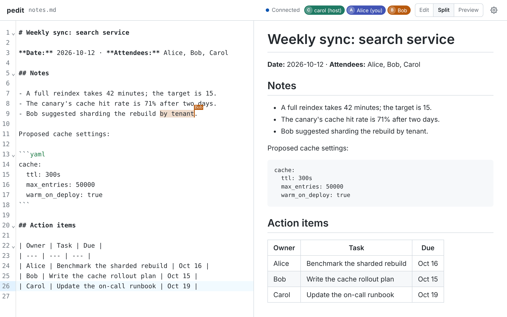
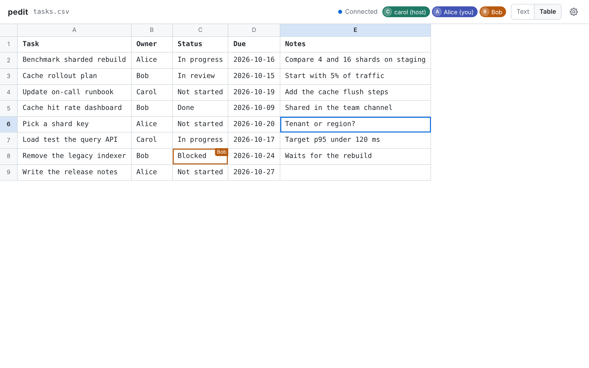
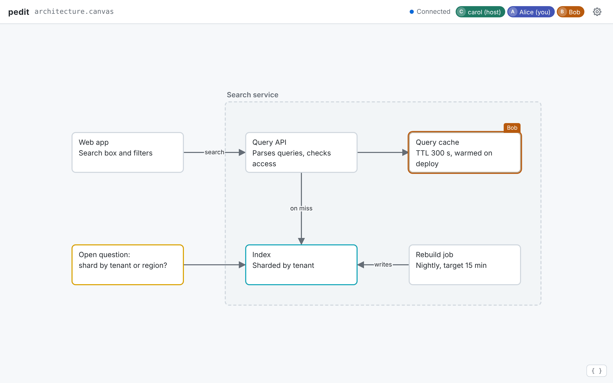
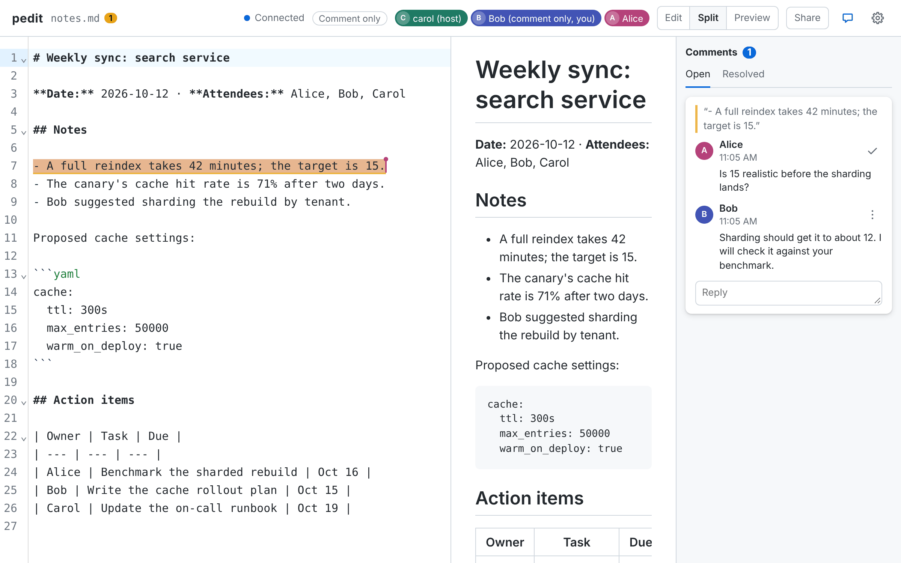

# pedit — Pair edit your local files.

[](https://github.com/piconic-ai/pedit/actions/workflows/ci.yml)
[](https://github.com/piconic-ai/pedit/releases/latest)
[](LICENSE)
[](https://scorecard.dev/viewer/?uri=github.com/piconic-ai/pedit)

https://github.com/user-attachments/assets/14bec9ab-8c14-495c-8faf-9cdd98d8fd5b

`pedit` is a CLI that lets people edit your local files together in their
browsers. Edits are saved back to your file:

```text
❯ pedit notes.md

  notes.md is ready to write together.

  Send this link to the people you want to invite:
    https://edit.piconic.ai/r/<room-id>#<key>

  Press Ctrl+C when you are done. Everything is saved to notes.md.
  To share another file in this room, type its path and press Enter.
  Press Ctrl+L for links that can only comment or read.

  ● Alice and Bob are here
```

No install or account needed for collaborators on the public server.

People in the room can also comment on text, table cells and canvas nodes;
comments never go into the file. The printed link lets people edit; Ctrl+L
shows links that let them only comment or only read.

**What it looks like.** Carol shares a file with `pedit`; Alice and Bob edit
it in their browsers. The first three are Alice's view; the last is Bob's,
opened from a comment-only link:

<table>
  <tr>
    <td><a href="docs/assets/screenshots/markdown.png"><picture>
      <source media="(prefers-color-scheme: dark)" srcset="docs/assets/screenshots/markdown-dark.png">
      
    </picture></a></td>
    <td><a href="docs/assets/screenshots/csv.png"><picture>
      <source media="(prefers-color-scheme: dark)" srcset="docs/assets/screenshots/csv-dark.png">
      
    </picture></a></td>
  </tr>
  <tr>
    <td>Markdown, with a live preview and Bob's cursor</td>
    <td>CSV as a table, with Bob's selected cell</td>
  </tr>
  <tr>
    <td><a href="docs/assets/screenshots/canvas.png"><picture>
      <source media="(prefers-color-scheme: dark)" srcset="docs/assets/screenshots/canvas-dark.png">
      
    </picture></a></td>
    <td><a href="docs/assets/screenshots/comments.png"><picture>
      <source media="(prefers-color-scheme: dark)" srcset="docs/assets/screenshots/comments-dark.png">
      
    </picture></a></td>
  </tr>
  <tr>
    <td>Canvas as a board, with Bob's selected node</td>
    <td>Comments, from a comment-only link</td>
  </tr>
</table>

## Why pedit?

Local files work naturally with coding agents and your own editor. Keeping
documents in Git makes changes reviewable and preserves their history, but
asking someone to clone a repository and open a pull request adds friction
to a quick editing session.

pedit lets you invite people into the file with a link and edit together in
their browsers. They do not need to set up your development environment.
The edits land in the same local file, ready for your next agent task,
review or commit.

## Install

macOS / Linux:

```sh
curl -fsSL https://edit.piconic.ai/install.sh | sh
```

Windows (PowerShell):

```powershell
irm https://edit.piconic.ai/install.ps1 | iex
```

`install.ps1` adds the install directory to your user PATH; set
`PEDIT_NO_MODIFY_PATH=1` to skip that.

To update a pedit installed this way, run `pedit self-update`; it checks the
release as the install scripts do before replacing anything.

`install.sh` and `install.ps1` are served by the relay. To install from
GitHub instead, use one of the methods below.

Homebrew (macOS / Linux):

```sh
brew install piconic-ai/tap/pedit
```

mise:

```sh
mise use -g github:piconic-ai/pedit
```

Go 1.25+:

```sh
go install github.com/piconic-ai/pedit/cmd/pedit@latest
```

Binaries: [GitHub Releases](https://github.com/piconic-ai/pedit/releases) (macOS / Linux / Windows · amd64 / arm64).
Every archive carries a build provenance attestation, which the install
scripts check when the GitHub CLI is installed; see
[verifying releases](docs/verifying-releases.md) to check one yourself.

## Usage

### Sharing a file

Run `pedit <file>` and send the printed link. Edits are saved to your file
as they come in, and if the connection drops, keep `pedit` running: it
reconnects with the same link and merges what was written meanwhile. Ctrl+C
saves and leaves.

A room opened from existing files is kept for a day after you leave: the
link keeps working, and what guests write while you are away waits on the
relay, encrypted. Run `pedit notes.md` again (or `pedit resume`) to take
their edits in and carry on, `pedit rooms` to list kept rooms, and
`pedit close` to end one for good (resume and close are not available on
Windows yet). `--keep 7d` keeps it longer (7 days at
most on the public relay); `--keep 0` opens a room that ends when you leave.
See [sessions](docs/sessions.md) for how reconnecting, saving and kept rooms
work.

### Joining from the command line

Collaborators who would rather stay in their own editor join from the command
line instead. Given the link, `pedit` mirrors the shared file to a temporary
copy and keeps it in sync both ways until they leave or the host closes the
room; the copy is removed then, like closing a browser tab:

```text
❯ pedit 'https://edit.piconic.ai/r/<room-id>#<key>'

  Joined. Your copy of the shared file:
    /tmp/pedit-<room-id>-2271/00-notes.md
    Copied to your clipboard.

  Edit it with any editor; changes sync both ways while you are in the room.
  Press Ctrl+C to leave. The copies are temporary and removed then.
```

Quote the link in the shell: `#` starts a comment otherwise. Copy out what you
want to keep before you leave. A canvas comes as its JSON Canvas, under
`.json` (`00-board.json`). See [sessions](docs/sessions.md#joining-from-the-command-line)
for how copies are named and synced.

### Several files in one room

Name several files to share them in one room, under one link. Guests switch
between them with the tabs above the editor:

```text
❯ pedit agenda.md docs/spec.md board.canvas
```

While sharing, type the path of another file and press Enter to add it to the
room, without a new link: a meeting can start with the agenda and bring in the
spec when it comes up. Only the host adds files; nobody in the room can ask for
one. A room shares up to 20 files, each a regular UTF-8 file, as when sharing
one. Paths are shown relative to the directory `pedit` runs in.

A guest who joins from the command line gets a copy of each text file in the
same temporary directory, including files the host adds later:
`docs/spec.md` is copied to `01-docs-spec.md`. Canvases are for the browser.

### Comments

In the browser, select some text, a cell of a table (or a whole row or
column), or a node of a canvas, and write a comment in the panel beside it.
Everyone in the room sees it at once, marked where it points, and can reply
or resolve it; resolved threads stay under Resolved, to read again or reopen.
You can edit or delete your own comments from their ⋮ menu (deleting asks
first). Each file's tab (or its name, in a room of one file) shows how
many of its comments are still open, and the speech bubble in the header,
or Ctrl/⌘+Alt+M, shows or hides the comments. A comment never goes into the file: the host keeps the
comments of each file in `.pedit/meta/<path>.json`, and the next session
shows them again, found by the text, cells or node they pointed at. A
comment follows its place as people edit, and says so when that text changed
or is gone. A comment goes on up to 1,000 characters of text, or of a cell.

Comments are kept for files inside the project: the directory of
`.pedit/config.yaml`, or the one you run pedit in when there is none. Commit
`.pedit/meta/` to keep them with the files. See
[the design](docs/design/comments.md) for how they are anchored.

### Comments from scripts and agents

A script or an AI agent can read and answer comments without a browser. It
runs the session itself, with `--json`, and reads what happens in the room
as JSON lines on stdout (messages for people go to stderr):

```sh
pedit notes.md --json --name tate-pm &   # {"event":"ready",...}, then
                                          # {"event":"comment","thread":"…","body":"…",...}
pedit comments list                       # the open threads (--all, --json)
pedit comments reply <thread> "Done."     # prints the reply's id
pedit comments resolve <thread>           # or reopen
```

The `pedit comments` commands talk to the session running on the same
machine, so the agent is one participant, named by `--name`. An agent that is
a guest does the same with `pedit <share link> --json`. With no session
running, `pedit comments list --file notes.md` lists the comments as the host
saved them last. `pedit comments --help` says more, and
[the design](docs/design/comments-cli.md) how it works.

### Comment-only and read-only links

The link pedit prints lets people edit. To let someone only comment, or only
read, press Ctrl+L while sharing, or choose Share in the browser's header, and
send one of these instead:

```text
  Links with less access:
    Comment only  https://edit.piconic.ai/r/<room-id>#c.<key>
    Read only     https://edit.piconic.ai/r/<room-id>#r.<key>
```

| Link | Read the files and comments | Write comments | Edit the files |
| --- | --- | --- | --- |
| Edit | ✓ | ✓ | ✓ |
| Comment only | ✓ | ✓ | |
| Read only | ✓ | | |

A comment-only link is offered while some file keeps comments. Each link
also gives the ones below it, never the ones above, and every peer checks what
the others may do, not the relay. A comment-only link also joins from the
command line, to read and answer comments (its copies of the files are not
sent back); a read-only link opens in a browser.

## Configuration and templates

Run `pedit` at a Git repository root to create `.pedit/config.yaml` and
`.pedit/templates/` with editable Markdown, CSV, and Canvas defaults.

```yaml
server: https://edit.piconic.ai
output: notes
keep: 7d   # optional: how long pedit <file> keeps its room (1d if unset, 0 turns it off)
```

Add your own template files directly to `.pedit/templates/`:

```sh
pedit                          # notes/pedit-<time>.md
pedit --csv                    # notes/pedit-<time>.csv
pedit --canvas                 # notes/pedit-<time>.canvas
pedit -t minutes.md             # notes/minutes-<time>.md
pedit -t minutes.md -d meetings # meetings/minutes-<time>.md
```

`.canvas` files use [JSON Canvas](https://jsoncanvas.org/), an open format for
whiteboard-style diagrams.

`-t` / `--template` selects a template; `-t csv` and `-t canvas` select
`default.csv` and `default.canvas`. `-d` / `--directory` overrides `output`.
New files get a timestamp and a counter if needed. Existing files are preserved.

Configuration is found from the current directory up to the Git root.
`output` is relative to the project; `-d` is relative to the current directory.
Without configuration, the public server and built-in defaults work immediately.
Set `server` in the config instead of `PEDIT_SERVER`.

## Privacy and security

In a browser, the editor's code comes from the relay, so you trust whoever
runs it and Cloudflare, which hosts it: a modified editor could read the key
and plaintext. The command line runs no code from the relay: guests can join
with `pedit '<link>'` instead of a browser, using a pedit installed from
Homebrew, `go install` or a [release archive you verify](docs/verifying-releases.md), not from `install.sh`
or `install.ps1`, which the relay serves. Or [self-host](#self-host) the relay and editor. See
[security design](docs/security-design.md) for the encryption and what it does
not protect against, and [the public relay](docs/public-relay.md) for what
`edit.piconic.ai` logs and keeps. The public relay's
[terms of use](https://edit.piconic.ai/terms) and
[privacy policy](https://edit.piconic.ai/privacy) are on the relay itself.


This is a simplified illustration: pedit encrypts document updates rather than
raw text. The relay sees the room ID and encrypted bytes, but not the key.
Edits in the opposite direction follow the same process.

- **End-to-end encryption.** Document updates and pasted images are encrypted
  on your devices. The relay receives ciphertext; the key stays in the link's
  `#fragment` and is never sent to the server.
- **Local files, temporary sessions.** The relay never stores plaintext. Kept
  rooms retain encrypted text until their deadline. Live rooms attempt to
  delete encrypted images when the host leaves
  ([what the public relay keeps](docs/public-relay.md#what-it-keeps)).
- **Private local copies.** On Unix, new CLI join copies and saved attachments
  use owner-only permissions, further restricted by your umask. Updates retain
  an existing document's permissions; existing files are not retroactively made private.
- **Comments are encrypted too.** They travel as updates of a document of
  their own, end to end like edits, and only the host saves them, in
  `.pedit/meta/`; commit that only if you want them in the repository. The
  editor lets you change or delete only your own comments, but anyone with
  an edit or comment-only link could change or delete any comment.
- **The link grants editing access.** Anyone with the full link can read and
  edit during the session. Share it only with people you trust, or send a
  [comment-only or read-only link](#comment-only-and-read-only-links), which
  cannot change the files: editors sign what they send, and every peer drops
  what a link cannot sign. Closing a session does not erase copies
  participants have made.
- **Room IDs alone do not grant access.** Clients derive a separate admission
  token from the fragment key. The relay checks this token before accepting
  connections or attachment requests; the token cannot decrypt content.
- **Your relay, your access rules.** Use the public relay at `edit.piconic.ai`,
  or [self-host](#self-host) to require sign-in with Cloudflare Access.
- **Only the files you share.** The CLI reads and writes the files you name,
  images in `assets/` beside each, its own `.pedit/` configuration and a cache, and runs
  only a clipboard tool, for Access `cloudflared`, and `gh` during `pedit self-update`. See
  [what pedit does on your computer](docs/local-files.md) for every file and
  what you accept.

You must also trust participant devices and browsers. Infrastructure can see
IP addresses, room IDs, request timing and ciphertext sizes; infrastructure and
Access logs have separate retention settings and are not erased when a room
closes.


Markdown previews can embed players such as YouTube, Figma or Miro, and
public source files on GitHub. An embed loads only when someone clicks "Load
from" on it (or chose "Always load" for its provider), so nobody contacts a
third party just because a URL was written in the file. See
[embeds](docs/embeds.md) for the list and options. With Access, avatars may
load from an identity provider or Gravatar using an email hash.

Besides the relay, the CLI itself connects only to `api.github.com`, to check
for a newer release, and keeps the answer for a day. Only `pedit self-update`
downloads a release, from `github.com`, and installs it after checking it.

To report a vulnerability, see [SECURITY.md](SECURITY.md).

## Self-host

The public relay at `edit.piconic.ai` is shared, so it has limits:

| | Public relay |
| --- | --- |
| People in a room | The host and 4 guests |
| Images | 5 MiB each, 50 MiB per session |
| New rooms | 20 a minute from one network |
| Connections | 60 a minute from one network |
| Session length | 24 hours |
| File size | About 1 MiB, on any relay ([details](docs/public-relay.md#limits)) |

Self-host when you need more, or when you want to limit who can join editing
sessions. Cloudflare Access lets you allow specific email addresses or identity
provider groups; participants need both an allowed identity and the session
link.

[](https://deploy.workers.cloudflare.com/?url=https%3A%2F%2Fgithub.com%2Fpiconic-ai%2Fpedit%2Ftree%2Fmain%2Fpackages)

The button copies only the server workspace (`packages/`), without the Go CLI.
Deploy the relay and browser editor to your Cloudflare account, then:

```sh
# Set server: https://<worker>.<subdomain>.workers.dev in .pedit/config.yaml
pedit notes.md
```

See [self-hosting notes](docs/self-hosting.md) for requirements and Access setup.

## Contributing

See [CONTRIBUTING.md](CONTRIBUTING.md) for development setup and pull requests.
