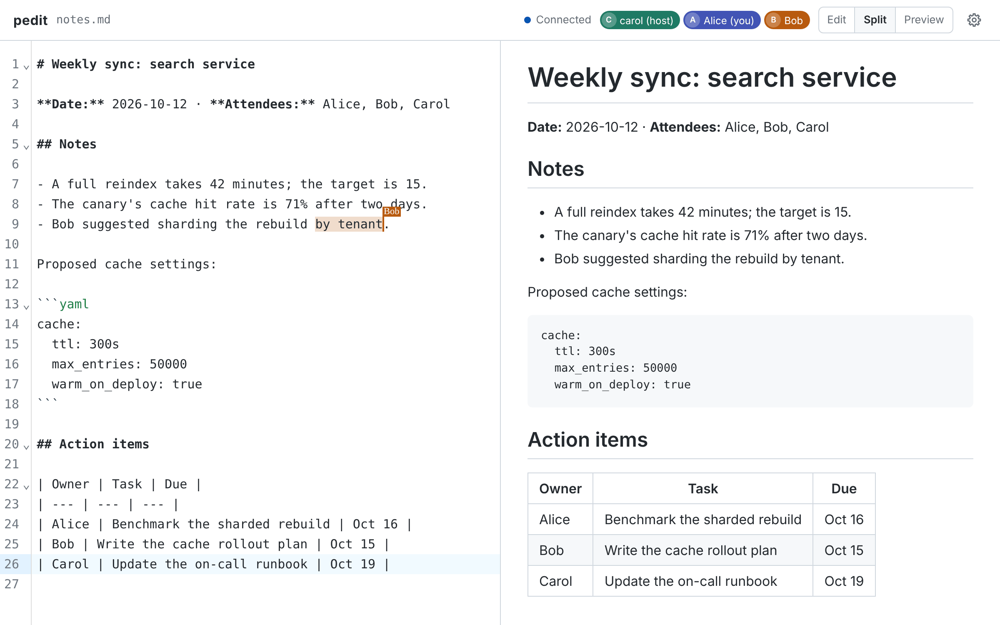
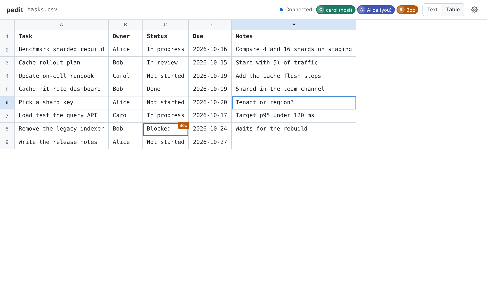
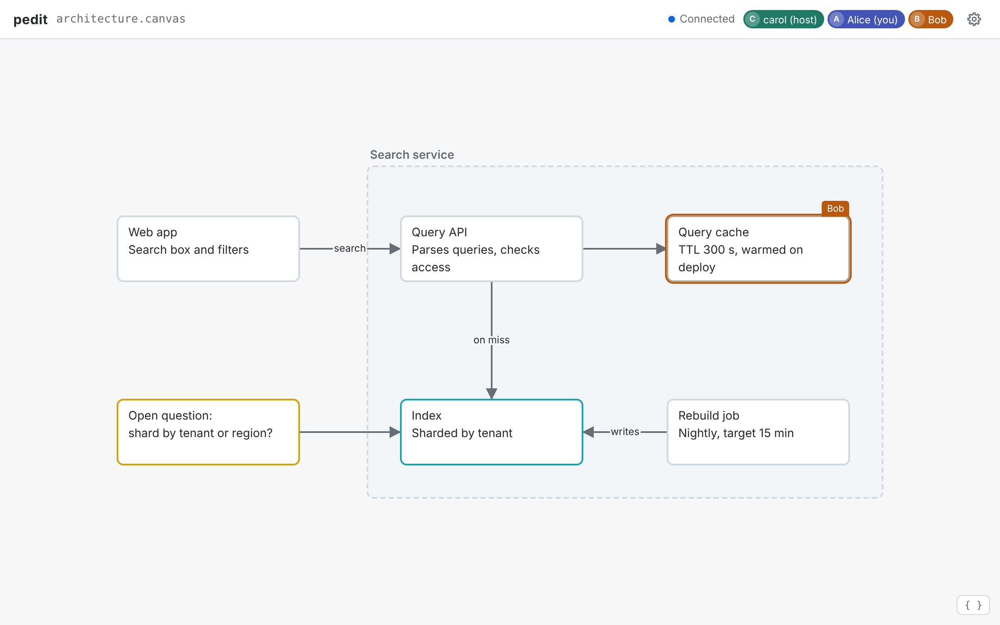

# pedit — Pair edit your local files.

[](https://github.com/piconic-ai/pedit/actions/workflows/ci.yml)
[](https://github.com/piconic-ai/pedit/releases/latest)
[](LICENSE)
[](https://scorecard.dev/viewer/?uri=github.com/piconic-ai/pedit)

https://github.com/user-attachments/assets/14bec9ab-8c14-495c-8faf-9cdd98d8fd5b

**What it looks like.** Carol shares a file with `pedit`; Alice and Bob edit
it in their browsers. This is Alice's view:

<table>
  <tr>
    <td><a href="docs/assets/screenshots/markdown.png"><picture>
      <source media="(prefers-color-scheme: dark)" srcset="docs/assets/screenshots/markdown-dark.png">
      
    </picture></a></td>
    <td><a href="docs/assets/screenshots/csv.png"><picture>
      <source media="(prefers-color-scheme: dark)" srcset="docs/assets/screenshots/csv-dark.png">
      
    </picture></a></td>
    <td><a href="docs/assets/screenshots/canvas.png"><picture>
      <source media="(prefers-color-scheme: dark)" srcset="docs/assets/screenshots/canvas-dark.png">
      
    </picture></a></td>
  </tr>
  <tr>
    <td>Markdown, with a live preview and Bob's cursor</td>
    <td>CSV as a table, with Bob's selected cell</td>
    <td>Canvas as a board, with Bob's selected node</td>
  </tr>
</table>

`pedit` is a CLI that lets people edit your local files together in their
browsers. Edits are saved back to your file:

```text
❯ pedit notes.md

  notes.md is ready to write together.

  Send this link to the people you want to invite:
    https://edit.piconic.ai/r/<room-id>#<key>

  Press Ctrl+C when you are done. Everything is saved to notes.md.

  ● Alice and Bob are here
```

No install or account needed for collaborators on the public server.

Collaborators who would rather stay in their own editor join from the command
line instead. Given the link, `pedit` mirrors the shared file to a temporary
copy and keeps it in sync both ways until they leave or the host closes the
room; the copy is removed then, like closing a browser tab:

```text
❯ pedit 'https://edit.piconic.ai/r/<room-id>#<key>'

  Joined. Your copy of the shared file:
    /tmp/pedit-<room-id>-2271/notes.md
    Copied to your clipboard.

  Edit it with any editor; changes sync both ways while you are in the room.
  Press Ctrl+C to leave. The copy is temporary and removed then; -d <dir> keeps one.
```

Quote the link in the shell: `#` starts a comment otherwise. `-d <dir>` keeps
the copy in that directory instead, where `pedit` refuses to overwrite a file
already there. Canvas rooms can only be joined in a browser for now.

## Why pedit?

Local files work naturally with coding agents and your own editor. Keeping
documents in Git makes changes reviewable and preserves their history, but
asking someone to clone a repository and open a pull request adds friction
to a quick editing session.

pedit lets you invite people into the file with a link and edit together in
their browsers. They do not need to set up your development environment.
The edits land in the same local file, ready for your next agent task,
review or commit.

## Install

macOS / Linux:

```sh
curl -fsSL https://edit.piconic.ai/install.sh | sh
```

`install.sh` is served by the relay. To install from GitHub instead, use one
of the methods below.

Homebrew (macOS / Linux):

```sh
brew install piconic-ai/tap/pedit
```

mise:

```sh
mise use -g github:piconic-ai/pedit
```

Go 1.25+:

```sh
go install github.com/piconic-ai/pedit/cmd/pedit@latest
```

Binaries: [GitHub Releases](https://github.com/piconic-ai/pedit/releases) (macOS / Linux / Windows · amd64 / arm64).
Each archive carries a build provenance attestation; check that it was built
by this repository's release workflow with

```sh
gh attestation verify <archive> --repo piconic-ai/pedit \
  --signer-workflow piconic-ai/pedit/.github/workflows/release-build.yml
```

(releases up to v0.1.2 were signed by `tagpr.yml` instead). Releases after
v0.1.5 also carry the attestation as a file, `pedit_<version>.sigstore.json`,
for `gh attestation verify <archive> --bundle <file> ...`. The archives are
reproducible: GoReleaser v2.18.3 (`goreleaser release --clean --skip=publish`
with `.goreleaser.yaml`) run on the same tag with the Go version from `go.mod`
on `ubuntu-24.04` gives the same `checksums.txt`. Releases made before the
switch to GoReleaser were built by `scripts/build-cli-release.sh`; their tags
still carry it, so rebuild those with that script instead.

## Configuration and templates

Run `pedit` at a Git repository root to create `.pedit/config.yaml` and
`.pedit/templates/` with editable Markdown, CSV, and Canvas defaults.

```yaml
server: https://edit.piconic.ai
output: notes
```

Add your own template files directly to `.pedit/templates/`:

```sh
pedit                          # notes/pedit-<time>.md
pedit --csv                    # notes/pedit-<time>.csv
pedit --canvas                 # notes/pedit-<time>.canvas
pedit -t minutes.md             # notes/minutes-<time>.md
pedit -t minutes.md -d meetings # meetings/minutes-<time>.md
```

`.canvas` files use [JSON Canvas](https://jsoncanvas.org/), an open format for
whiteboard-style diagrams.

`-t` / `--template` selects a template; `-t csv` and `-t canvas` select
`default.csv` and `default.canvas`. `-d` / `--directory` overrides `output`.
New files get a timestamp and a counter if needed. Existing files are preserved.

Configuration is found from the current directory up to the Git root.
`output` is relative to the project; `-d` is relative to the current directory.
Without configuration, the public server and built-in defaults work immediately.
Set `server` in the config instead of `PEDIT_SERVER`.

## Privacy and security

In a browser, the editor's code comes from the relay, so you trust whoever
runs it and Cloudflare, which hosts it: a modified editor could read the key
and plaintext. The command line runs no code from the relay: guests can join
with `pedit '<link>'` instead of a browser, using a pedit installed from
Homebrew, `go install` or a release archive you verify, not from `install.sh`,
which the relay serves. Or [self-host](#self-host) the relay and editor. See
[security design](docs/security-design.md) for the encryption and what it does
not protect against, and [the public relay](docs/public-relay.md) for what
`edit.piconic.ai` logs and keeps.


This is a simplified illustration: pedit encrypts document updates rather than
raw text. The relay sees the room ID and encrypted bytes, but not the key.
Edits in the opposite direction follow the same process.

- **End-to-end encryption.** Document updates and pasted images are encrypted
  on your devices. The relay receives ciphertext; the key stays in the link's
  `#fragment` and is never sent to the server.
- **Local files, temporary sessions.** The relay does not store document text,
  and attempts to delete encrypted images when the host leaves
  ([what the public relay keeps](docs/public-relay.md#what-it-keeps)).
- **Private local copies.** On Unix, new CLI join copies and saved attachments
  use owner-only permissions, further restricted by your umask. Updates retain
  an existing document's permissions; existing files are not retroactively made private.
- **The link grants editing access.** Anyone with the full link can read and
  edit during the session. Share it only with people you trust. Closing a
  session does not erase copies participants have made.
- **Room IDs alone do not grant access.** Clients derive a separate admission
  token from the fragment key. The relay checks this token before accepting
  connections or attachment requests; the token cannot decrypt content.
- **Your relay, your access rules.** Use the public relay at `edit.piconic.ai`,
  or [self-host](#self-host) to require sign-in with Cloudflare Access.
- **Only the file you share.** The CLI reads and writes the shared file, images
  in `assets/` beside it, its own `.pedit/` configuration and a cache, and runs
  only a clipboard tool and, for Access, `cloudflared`. See
  [what pedit does on your computer](docs/local-files.md) for every file and
  what you accept.

You must also trust participant devices and browsers. Infrastructure can see
IP addresses, room IDs, request timing and ciphertext sizes; infrastructure and
Access logs have separate retention settings and are not erased when a room
closes.

Markdown previews can show players for a link on a line of its own from
YouTube, Vimeo, Loom, Figma (designs, FigJam boards, slides and prototypes),
CodePen, StackBlitz, Observable, Spotify, SoundCloud (its Share > Embed player
URL) and Miro, and external images, videos and frames where the relay allows
them (the public relay does not). A player loads only when someone clicks
"Load from" on it, so nobody in the room contacts
a third party just because a URL was written in the file. Ticking "Always load"
next to it loads that provider's players right away from then on, in your
browser only; Settings lists the providers you chose and can forget each. With Access,
avatars may load from an identity provider or Gravatar using an email hash.
Those providers can see the requests.

Besides the relay, the CLI itself connects only to `api.github.com`, to check
for a newer release, and keeps the answer for a day; it never downloads or
installs one.

To report a vulnerability, see [SECURITY.md](SECURITY.md).

## Self-host

The public relay at `edit.piconic.ai` is shared, so it has limits:

| | Public relay |
| --- | --- |
| People in a room | The host and 4 guests |
| Images | 5 MiB each, 50 MiB per session |
| New rooms | 20 a minute from one network |
| Connections | 60 a minute from one network |
| Session length | 24 hours |
| File size | About 1 MiB, on any relay ([details](docs/public-relay.md#limits)) |

Self-host when you need more, or when you want to limit who can join editing
sessions. Cloudflare Access lets you allow specific email addresses or identity
provider groups; participants need both an allowed identity and the session
link.

[](https://deploy.workers.cloudflare.com/?url=https%3A%2F%2Fgithub.com%2Fpiconic-ai%2Fpedit%2Ftree%2Fmain%2Fpackages)

The button copies only the server workspace (`packages/`), without the Go CLI.
Deploy the relay and browser editor to your Cloudflare account, then:

```sh
# Set server: https://<worker>.<subdomain>.workers.dev in .pedit/config.yaml
pedit notes.md
```

See [self-hosting notes](docs/self-hosting.md) for requirements and Access setup.

## Contributing

See [CONTRIBUTING.md](CONTRIBUTING.md) for development setup and pull requests.
